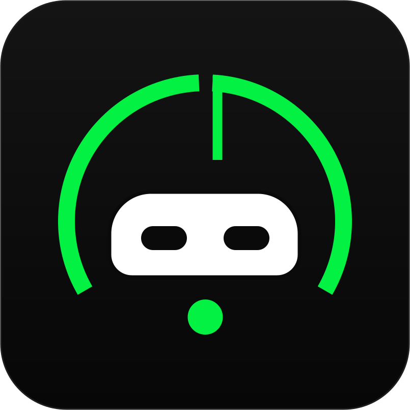
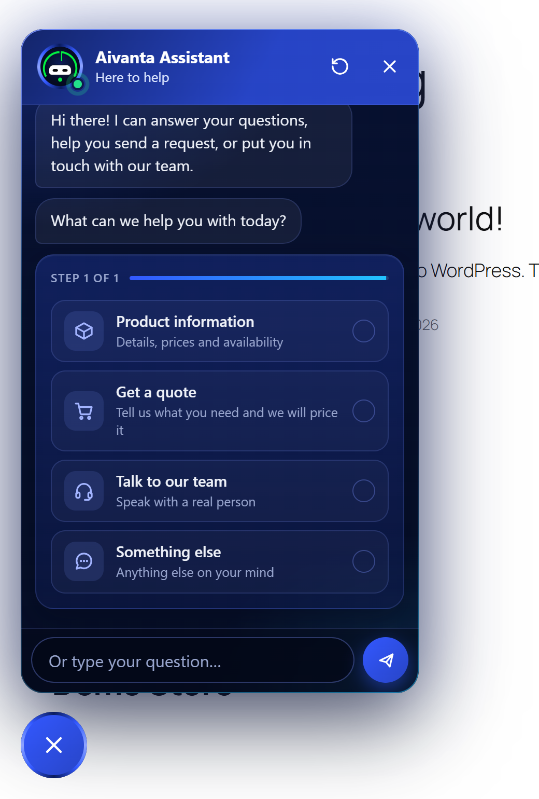
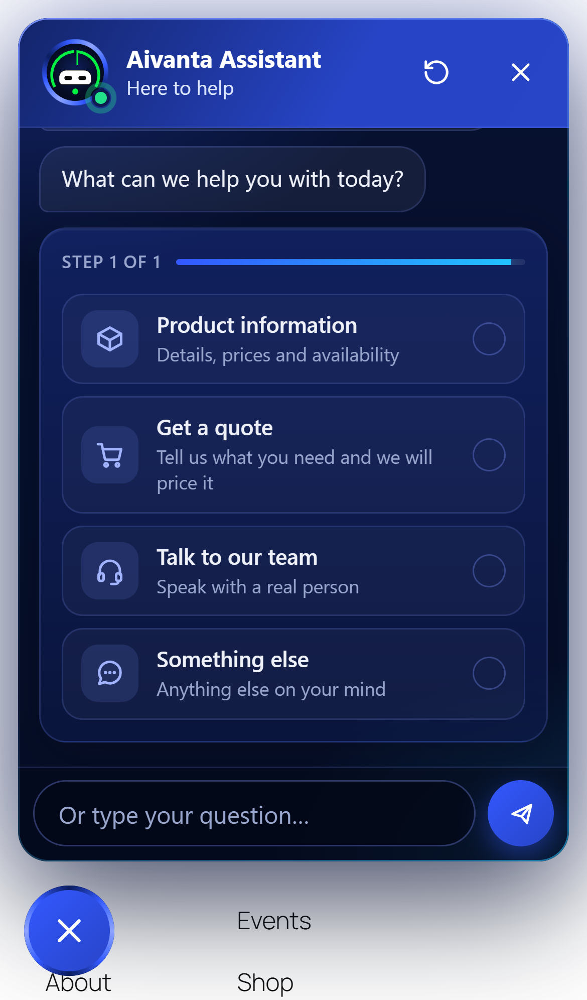
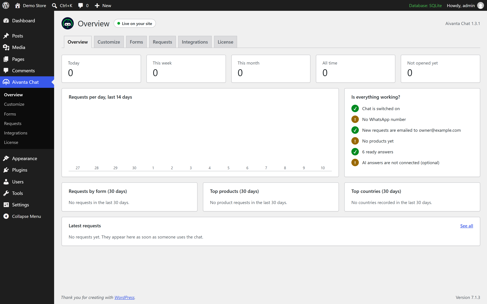
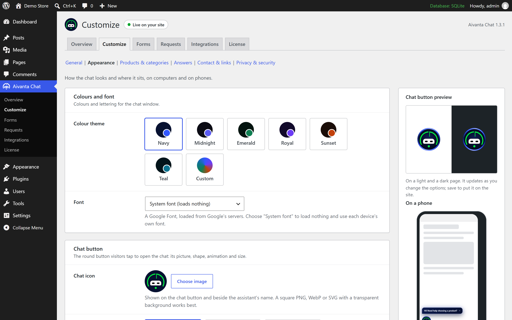
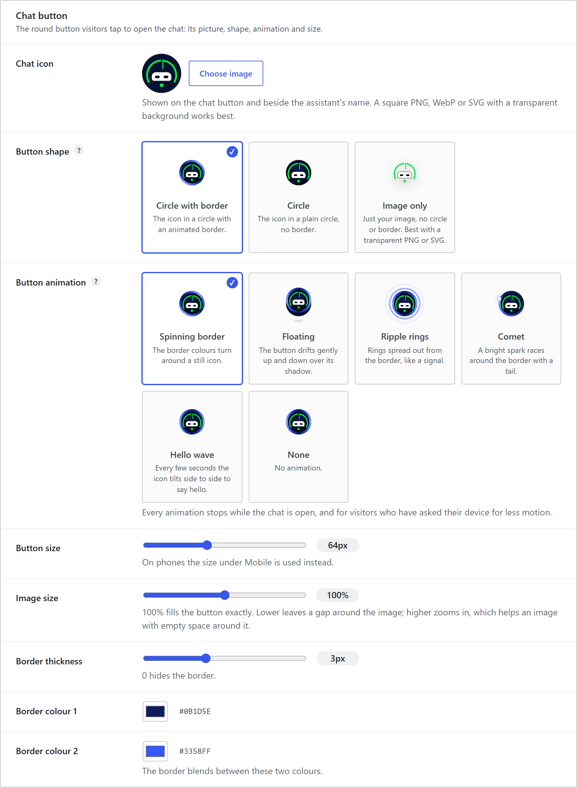
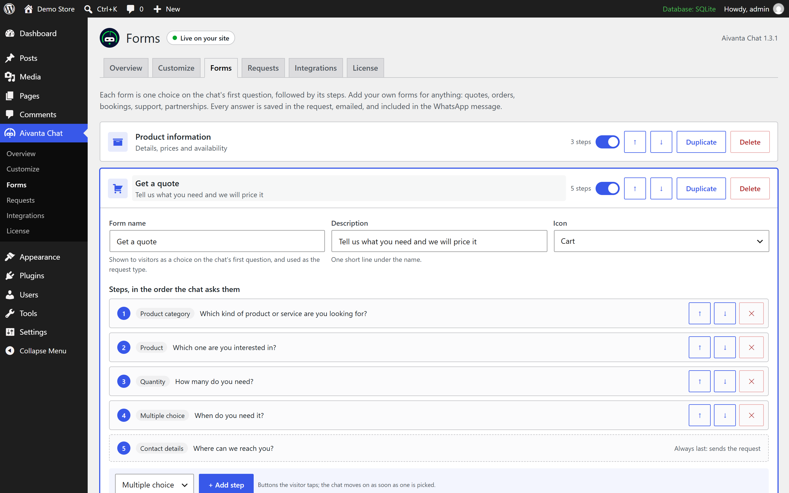
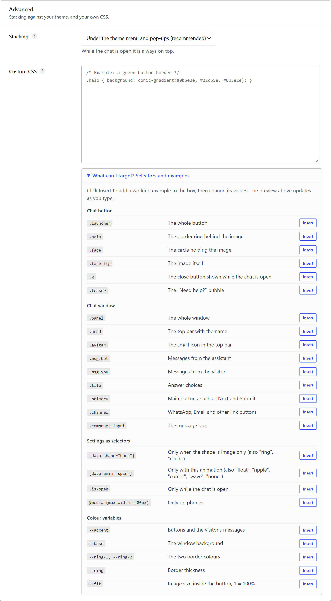

  

<h1 align="center">Aivanta Chat</h1>

  A chat assistant for WordPress that answers visitors, guides them through your own forms, 
  and hands every request to your team by email and WhatsApp.

  <b>Version 1.3.1</b> · WordPress 5.3+ · PHP 7.2+ · English and Arabic

---

> **This repository is a showcase.** It documents the plugin and its progress.
> The source code is private. If you'd like Aivanta Chat on your site, see [Get it](#get-it).

  
  &nbsp;&nbsp;
  

## What it does

- **Guided conversations.** Visitors pick what they need, such as product information, a quote, or a word with your team. The chat then walks them through the steps you defined.
- **A form builder, not a script.** Build any flow from choices, typed answers, product pickers, quantities and contact details. Reorder, duplicate or switch forms off without touching code.
- **Answers on its own.** Ready answers with synonyms, typo tolerance and Arabic support. An optional AI mode (Claude or OpenAI, using your own key) covers questions the ready answers don't.
- **Nothing gets lost.** Every request is saved in WordPress first, then emailed, and can open in WhatsApp with all the details filled in.
- **Built for real sites.** The chat renders in its own isolated layer, so theme CSS can't break it and it can't break the theme. On phones it sits under your menu until it's opened, then above everything.

## The dashboard

An overview with requests per day, top forms, products and countries, and a checklist that shows what still needs setting up.

### Appearance with a live preview

Every change shows instantly on a light page, a dark page and a phone, drawn with the same stylesheet visitors get.

### Five button animations, three shapes

Spinning border, Floating, Ripple rings, Comet and Hello wave, or none. The button can be a circle with an animated border, a plain circle, or just your image on its own. Size, image fit, border thickness and colours all have sliders.

### Forms

### Custom CSS with a built-in guide

For anyone who wants to go further: a CSS box that only affects the chat, and a guide to every selector with one-click working examples.

## Security and privacy

- Every post from the chat carries a short-lived token signed with the site's own keys. Request tokens are single-use.
- Posts from other websites, oversized bodies and non-JSON bodies are refused before anything is read.
- Limits per visitor and daily ceilings for the whole site, for requests and for AI answers.
- Answers are checked against the saved form on the server. Prices and totals are never taken from the browser.
- The AI key is encrypted at rest and never sent to browsers.
- IP addresses are used only for rate limits and never stored. WordPress's Export and Erase Personal Data tools cover chat requests.

## Progress

See the [changelog](CHANGELOG.md) for what changed in each release.

## Get it

Aivanta Chat is **available on request**. For pricing, a demo, or a setup on your site, email
**[Chaosmp81@gmail.com](mailto:Chaosmp81@gmail.com)**.

---

Designed and built by <b>NERFLESS</b> · © 2026

