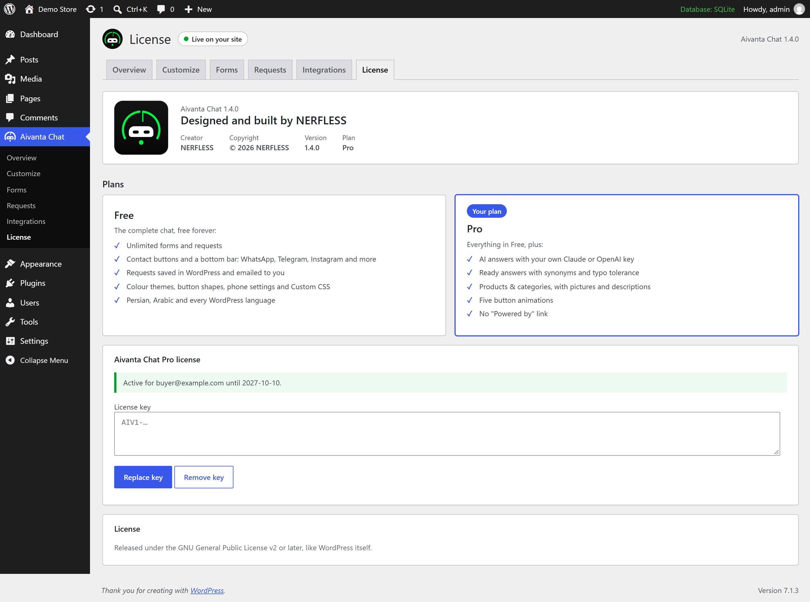
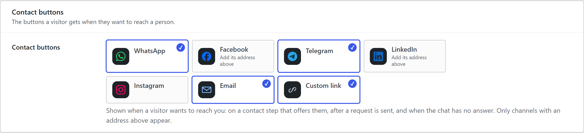
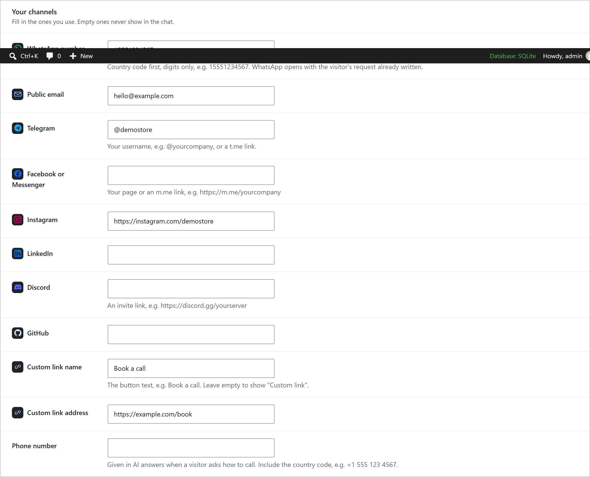
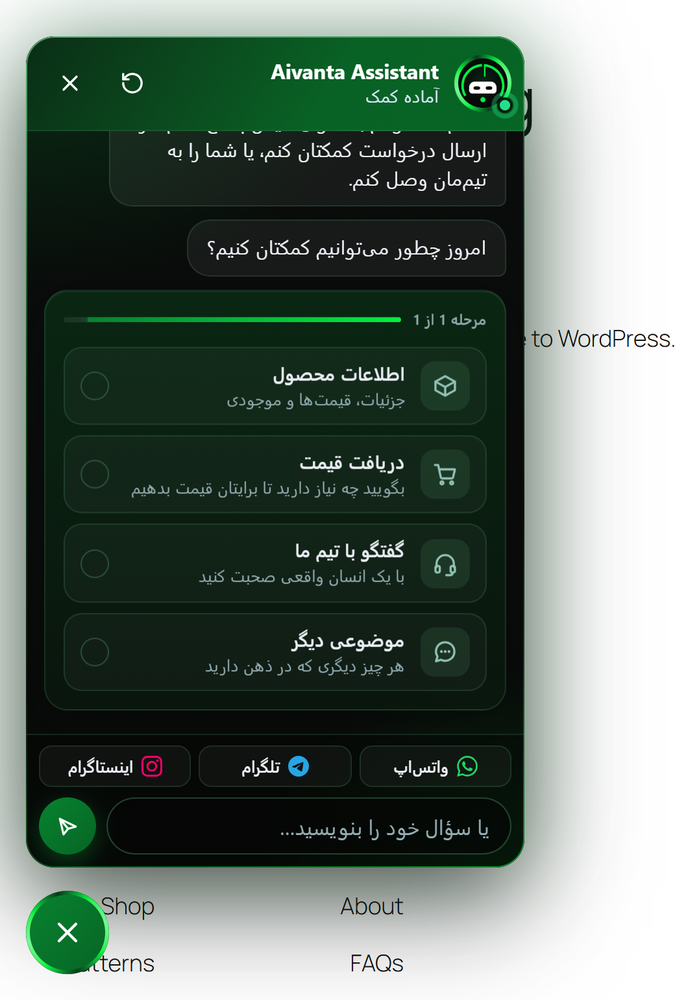
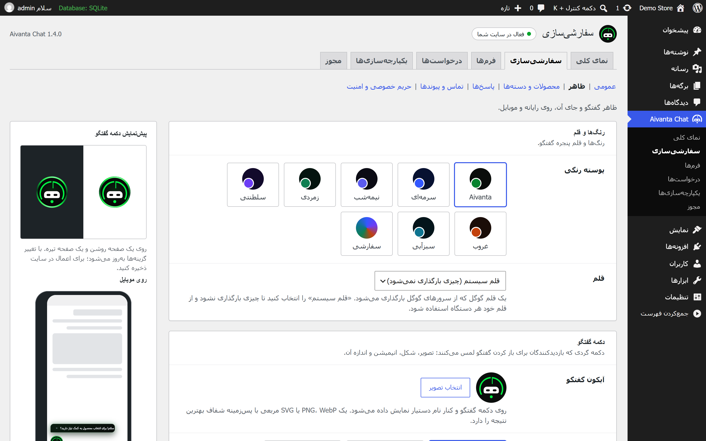

  

<h1 align="center">Aivanta Chat</h1>

  A chat assistant for WordPress that guides visitors through your own forms 
  and hands every request to your team: inbox, WhatsApp, Telegram and more.

  <b>Free 1.4.0</b> · <b>Pro add-on 1.0.0</b> · WordPress 5.3+ · PHP 7.2+ · English, Persian, Arabic

---

> **This repository is a showcase.** It documents the plugin and its progress.
> The source code is private. If you'd like Aivanta Chat on your site, see [Get it](#get-it).

  
  &nbsp;&nbsp;
  

## What it does

- **Guided conversations.** Visitors pick what they need (product information, a quote, a word with your team) and the chat walks them through the steps you defined.
- **A form builder, not a script.** Build any flow from choices, typed answers, form fields, quantities and contact details. Reorder, duplicate or switch forms off without touching code.
- **Every channel you use.** WhatsApp, Telegram, Messenger, Instagram, LinkedIn, Discord, GitHub, email or a custom link, each with its own icon.
- **Nothing gets lost.** Every request is saved in WordPress first, then emailed, and WhatsApp or email can open with the whole request already written.
- **Built for real sites.** The chat renders in its own isolated layer, so theme CSS can't break it and it can't break the theme. On phones it sits under your menu until it's opened, then above everything.

## Free and Pro

The free plugin is complete on its own. Pro is an add-on that installs beside it.

| | Free | Pro |
|---|:---:|:---:|
| Unlimited forms and requests | ✓ | ✓ |
| Contact buttons and bottom bar with brand icons | ✓ | ✓ |
| Requests saved in WordPress and emailed | ✓ | ✓ |
| Colour themes, button shapes, phone settings, Custom CSS | ✓ | ✓ |
| Persian, Arabic and every WordPress language | ✓ | ✓ |
| AI answers with your own Claude or OpenAI key | | ✓ |
| Ready answers with synonyms and typo tolerance | | ✓ |
| Products & categories with pictures | | ✓ |
| Five button animations | | ✓ |
| No "Powered by" link (opt-in on Free) | | ✓ |

Pro is unlocked with a license key that is checked on your own server: no account, no tracking, nothing sent anywhere. If a subscription ends, Pro switches off and Free keeps working, with everything you set up kept for renewal.

## Contact channels

Fill in the channels you use, then choose which appear as **contact buttons** (when a visitor wants a person, after a request, and when the chat has no answer) and which three sit in the **bottom bar**.

## Your language

  

The plugin follows the language set in WordPress. Persian and Arabic ship complete, with right-to-left layout and the Vazirmatn font, and the plugin can be translated into any other language. Arabic-speaking visitors on a site in another language get Arabic replies.

## The dashboard

An overview with requests per day, top forms, products and countries, and a checklist that shows what still needs setting up.

### Appearance with a live preview

Every change shows instantly on a light page, a dark page and a phone, drawn with the same stylesheet visitors get.

### Shapes and animations

Three shapes on Free. Pro adds five animations: Spinning border, Floating, Ripple rings, Comet and Hello wave.

### Forms

### Custom CSS with a built-in guide

## Security and privacy

- Every post from the chat carries a short-lived token signed with the site's own keys. Request tokens are single-use.
- Posts from other websites, oversized bodies and non-JSON bodies are refused before anything is read.
- Limits per visitor and daily ceilings for the whole site, for requests and for AI answers.
- Answers are checked against the saved form on the server. Prices and totals are never taken from the browser.
- The AI key (Pro) is encrypted at rest and never sent to browsers.
- IP addresses are used only for rate limits and never stored. WordPress's Export and Erase Personal Data tools cover chat requests.
- The free plugin passes WordPress's official Plugin Check with no errors.

## Progress

See the [changelog](CHANGELOG.md) for what changed in each release.

## Get it

Aivanta Chat is **available on request**. For pricing, a demo, or a setup on your site, email
**[Chaosmp81@gmail.com](mailto:Chaosmp81@gmail.com)**.

---

Designed and built by <b>NERFLESS</b> · © 2026

